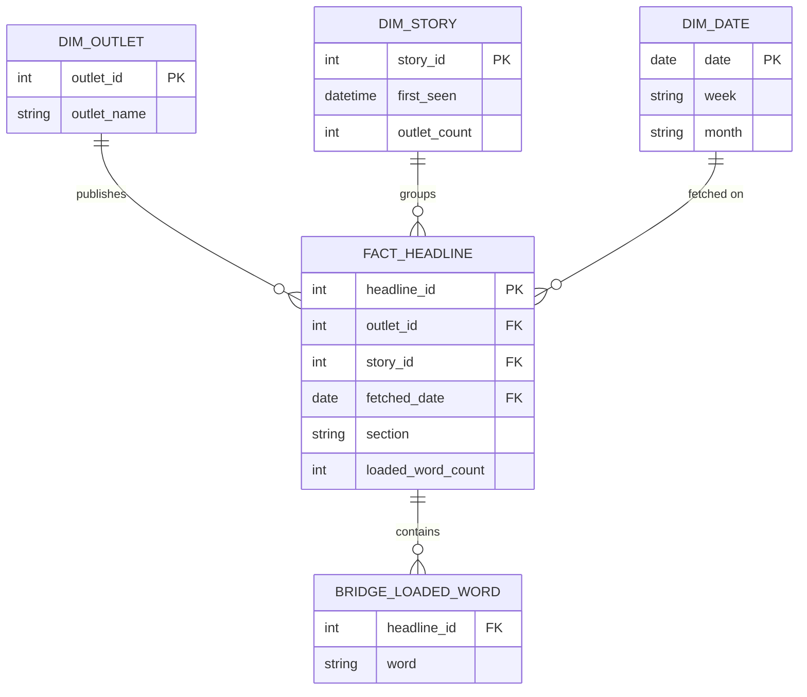

# Ek Khabar SQL Analysis
SQL analyses of 42,510 headlines from 10 Pakistani news outlets, collected by my project Ek Khabar every 30 minutes.

## Data
Source: Ek Khabar's SQLite database (latest GitHub release). Not included in this repo.

## Data dictionary
| Table | One row means | Rows | Important columns |
| --- | --- | --- | --- |
| headlines | one headline from one outlet's RSS feed | [N] | id (key), outlet, title, url, published (can be empty), fetched_at, section |
| stories | which story (news event) one headline belongs to | [N] | headline_id (links to headlines.id), story_id, clustered_at |
| meta | one setting saved by the pipeline | [N] | key, value |
| sqlite_sequence | SQLite's internal ID counter, not analysis data | - | name, seq |

## Target star schema (to build in Phase 2)

Grain of the fact table: one row = one headline. The bridge table is needed because one headline can contain several loaded words, and one word appears in many headlines (many-to-many).

## Findings
1. **Headlines per outlet per week:** Headlines per outlet per week: Minute Mirror publishes the most (about X a week), followed by Business Recorder and Dawn; APP publishes the least (about Y a week, tracked for only 5 weeks because it was added later). Data check: some feeds include old articles (e.g. a Dawn headline from 2022), so all queries only count headlines published after collection began on 17 September 2026.
2. 
