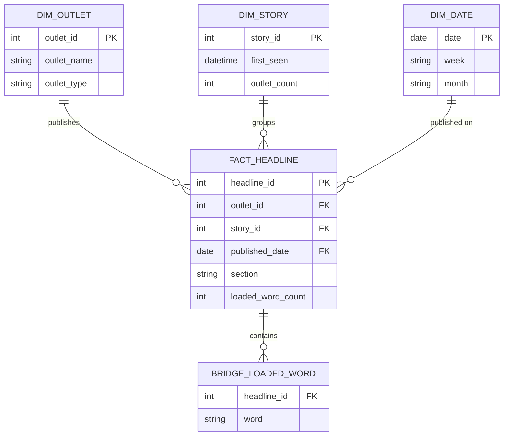

# Ek Khabar SQL Analysis
SQL analyses of 8,000+ headlines from 11 Pakistani news outlets, collected by my project Ek Khabar.

## Data
Source: Ek Khabar's SQLite database (latest GitHub release). Not included in this repo.

## Data dictionary
| Table | One row means | Rows | Important columns |
| --- | --- | --- | --- |
| headlines | one headline from one outlet | 8,123 | id, outlet, title, published_at, story_id |
| ... | ... | ... | ... |

## Star schema

## Findings
1. **Headlines per outlet per week:** (your finding here)
